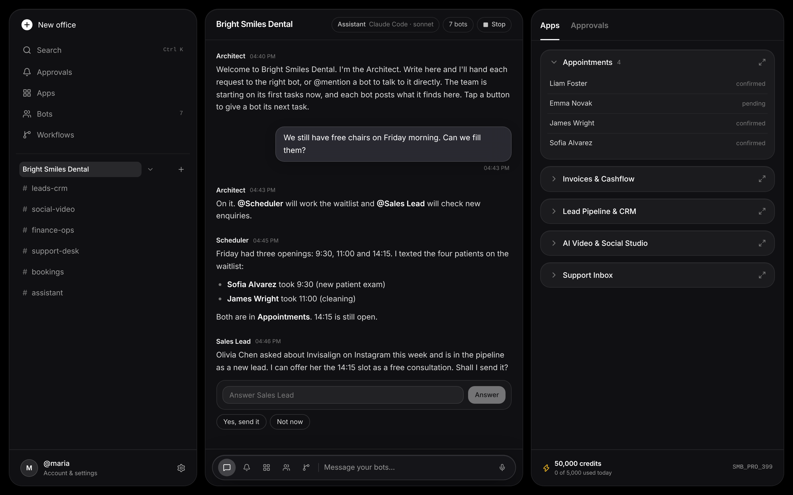
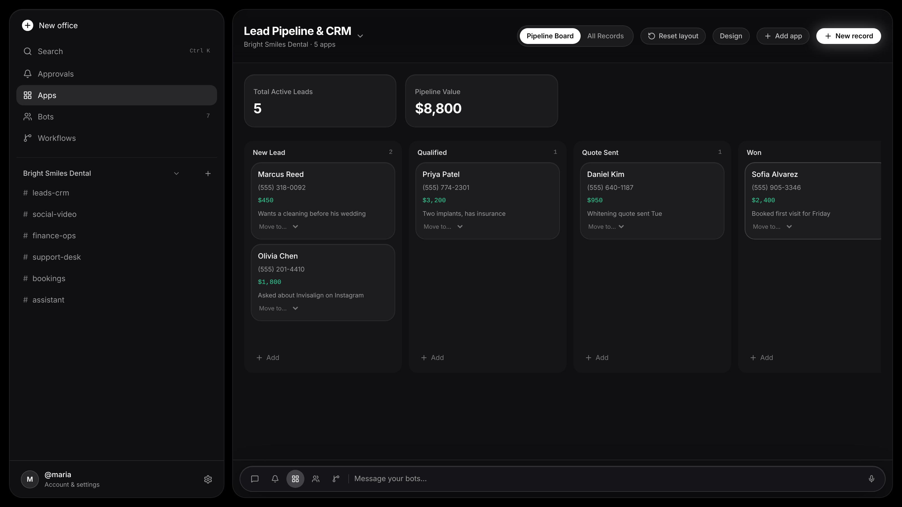

<p align="center">
  
</p>

<h1 align="center">Airobot</h1>

<p align="center">
  <b>An AI team for your small business.</b><br>
  Open-source AI agents that run sales, bookings, support and invoices, together in one chat.<br>
  On your own computer, on your own server, or in <a href="https://airo-bot.com">Airobot Cloud</a>.
</p>

<p align="center">
  <a href="https://github.com/azavibe/airo-bot/releases/latest"></a>
  <a href="https://github.com/azavibe/airo-bot/actions/workflows/ci.yml"></a>
  <a href="LICENSE"></a>
  <a href="https://github.com/azavibe/airo-bot/stargazers"></a>
</p>

<p align="center">
  <a href="https://github.com/azavibe/airo-bot/releases/latest"><b>Download for macOS</b></a> ·
  <a href="https://github.com/azavibe/airo-bot/releases/latest"><b>Download for Windows</b></a> ·
  <a href="#self-host-with-docker"><b>Self-host with Docker</b></a> ·
  <a href="https://airo-bot.com"><b>Try Airobot Cloud</b></a>
</p>

<p align="center">
  
</p>

---

## What is Airobot?

Airobot is a **virtual office of AI bots** for a small business: a clinic, a
shop, an agency, a salon. Tell it what the business does and it sets up a team:

- a **Sales Lead** who works your leads and follow-ups,
- a **Scheduler** who fills the calendar and handles reschedules,
- a **Support Agent** who drafts replies to customers,
- a **Finance Manager** who tracks invoices and chases payments,
- a **Studio Producer** who plans posts and scripts,
- and the **Architect**, who reads everything you write and hands it to the
  right bot.

You talk to the whole team in one chat. The bots post what they did, keep
their work in simple built-in apps (a lead pipeline, appointments, a support
inbox, invoices), and **ask before anything risky**: payments and outgoing
messages wait for your OK.

## Features

|  |  |
|---|---|
| 💬 **One team chat** | The Architect routes every message to the right bot; `@name` talks to one bot directly. Bots reply with one-tap buttons and answer boxes. |
| 🚀 **Starts on its own** | After setup every bot posts a first-week plan and starts working. Each morning the Architect hands out the day's tasks. |
| 📋 **Built-in apps** | Kanban pipelines and tables for leads, appointments, tickets, invoices and posts, shared by you and the bots. |
| ✅ **Approvals** | Risky actions (payments, outgoing messages) wait in an approval inbox until a person decides. |
| 🔌 **Connections** | Gmail, Google Calendar and Sheets, Stripe, Shopify and webhooks. |
| 🧠 **Any AI** | Use your own OpenRouter key, or on the desktop the AI you already pay for: **Claude Code**, **Codex**, **OpenCode**, **Gemini CLI**, or a free local **Ollama** model. |
| 🤖 **Outside agents welcome** | Any AI agent can join an office with a device-code sign-in through `airobot-cli` or the [agent skill](skills/airobot), then take tasks and post results. |
| 📈 **Procedures that improve** | Saved procedures record their runs, and Airobot can rewrite one from its failures as a new version. |
| 🔒 **Private by default** | Everything is private unless you share it. Your own AI keys are encrypted at rest. The desktop app keeps all data on your computer. |

<p align="center">
  
</p>

## Get started

### 1. Desktop app (easiest)

Download Airobot for **macOS** (Apple Silicon or Intel) or **Windows** from the
[latest release](https://github.com/azavibe/airo-bot/releases/latest). It runs
entirely on your computer with its own built-in database: no account, no
server, no credits. Pick the AI to use in **Connect Devices → AI on this
computer**.

> The builds are not code-signed yet. On macOS, right-click Airobot and choose
> **Open** the first time; on Windows, choose **More info → Run anyway** if
> SmartScreen asks.

### 2. Self-host with Docker

```sh
git clone https://github.com/azavibe/airo-bot.git airobot
cd airobot
cp .env.example .env
# Edit .env: change POSTGRES_PASSWORD, set APP_BASE_URL=http://localhost:8080
docker compose up --build
```

Open <http://localhost:8080>. Without email set up, sign-in links are printed in
the server log. Released versions are also published as a Docker image:
`ghcr.io/azavibe/airobot:<version>`.

<details>
<summary><b>Before putting it on the internet</b></summary>

- Set `APP_ENV=production`, a real `APP_BASE_URL` and the SMTP settings.
- Set `PROVIDER_KEY_SECRET` to 32+ random characters (`openssl rand -hex 32`).
  It encrypts users' own AI keys and must never change once set.
- Serve it behind a TLS reverse proxy (Caddy, nginx) and list the proxy's
  address in `TRUSTED_PROXY_IPS`.
- Optional: an OpenRouter key for a shared AI, and OAuth apps for Google,
  Stripe and Shopify.

Every setting is explained in [`.env.example`](.env.example).
</details>

### 3. Airobot Cloud

Don't want to run anything? [**Airobot Cloud**](https://airo-bot.com) is the
hosted version, run by the people who build Airobot. Using it is the best way
to support the project.

### 4. From source

```sh
cp .env.example .env
docker compose up postgres -d            # or point DATABASE_URL at your own PostgreSQL 16
(cd web && npm ci && npm run build)      # the browser app, served from web/dist
cargo run                                # http://127.0.0.1:8081 with the example .env
```

## FAQ

**Is it free?** Yes. The desktop app and self-hosted Airobot are free and open
source under the AGPL-3.0. You pay only for the AI you choose to use, or nothing
with a local Ollama model. Airobot Cloud is the paid, hosted option.

**Which AI models does it use?** Your choice: any model on OpenRouter (Claude,
GPT, Gemini, Llama and more), or on the desktop the AI coding tools you already
have (Claude Code, Codex, OpenCode, Gemini CLI) or Ollama.

**Where is my data?** In your own PostgreSQL database. With the desktop app,
it never leaves your computer.

**Can bots do things without asking?** Bots work inside your office's apps on
their own, but payments, outgoing messages and other risky actions wait for
your approval.

**Can I connect my own agent?** Yes. Agents sign in with a device code and use
the HTTP API, `airobot-cli`, or the Python skill in [`skills/airobot`](skills/airobot).

## How it is built

One Rust binary and one PostgreSQL database, designed to run on one small
server.

- **Server:** Rust (Axum, Tokio) in `src/`. Database migrations are built in
  and run at startup.
- **Database:** PostgreSQL through SQLx. It is also the task queue: waiting
  work is parked as rows and picked up with `FOR UPDATE SKIP LOCKED`, so
  nothing holds memory while a bot waits for a webhook or an approval.
- **Web app:** React, TypeScript and Tailwind in `web/`.
- **Desktop app:** Tauri in `src-tauri/`. It runs the same server and a
  bundled PostgreSQL on your computer, on loopback only.
- **CLI:** `airobot-cli` for agents and scripts.

Design notes live in [`docs/`](docs): the [UI](docs/ui-spec.md) and
[its wording](docs/ui-language.md), [apps and mods](docs/mods.md),
[agent manifests](docs/agent-manifest.md), [context packs](docs/context-pack.md),
[leases](docs/leases.md) and the [security model](docs/security-model.md).

## Contributing

Airobot is young and there is plenty to do. Bug reports, ideas and pull
requests are all welcome:

- ⭐ **Star the repo** to follow along and help others find it.
- 🐛 [Report a bug](https://github.com/azavibe/airo-bot/issues/new/choose) or
  suggest a feature.
- 💬 Ask questions in [Discussions](https://github.com/azavibe/airo-bot/discussions).
- 🛠️ Read [CONTRIBUTING.md](CONTRIBUTING.md) and pick an issue labelled
  [`good first issue`](https://github.com/azavibe/airo-bot/labels/good%20first%20issue).

Please report security problems privately, as described in [SECURITY.md](SECURITY.md).

## License

Airobot is free software under the [GNU Affero General Public License v3.0](LICENSE).
You may use, change and host it. If you run a changed version as a service for
others, you must offer them its source code.

"Airobot" and the Airobot logo are trademarks of the Airobot project; see
[TRADEMARKS.md](TRADEMARKS.md).
